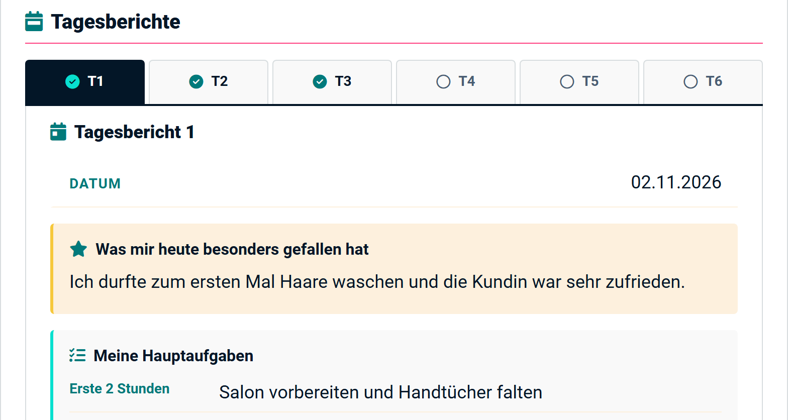
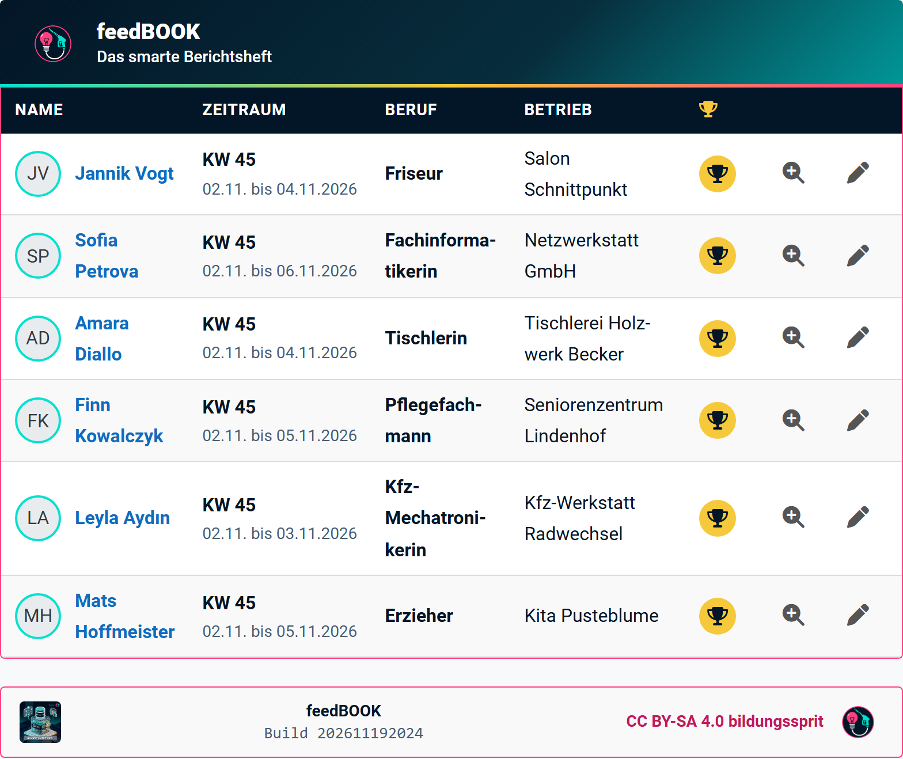

# feedBOOK
**Handreichung für Lehrkräfte  ·  Moodle-Datenbank von bildungssprit**

Das feedBOOK ist ein digitales Berichtsheft für das Betriebspraktikum. Ein Eintrag ist eine Praktikumswoche: Lernende schreiben für jeden Tag auf, was sie gemacht haben und was ihnen gefallen hat, und ziehen am Ende der Woche ein persönliches Fazit. So entsteht neben dem Nachweis ein Gesprächsanlass für die Nachbereitung.

## So kommt die Datenbank in deinen Kurs

1. Schalte im Kurs den Bearbeitungsmodus ein und lege im passenden Abschnitt eine Aktivität **Datenbank** an, zum Beispiel „feedBOOK Woche 1“.
2. Öffne in der Datenbank den Reiter **Vorlagensätze** und klicke oben rechts auf **Aktionen**, dann auf **Vorlagensatz importieren**. In einer leeren Datenbank bietet Moodle denselben Knopf auch direkt an.
3. Wähle die Datei `bs_db_003_feedBOOK-preset.zip` im Feld **Vorlagendatei** aus und klicke auf **Vorlagensatz importieren und anwenden**.
4. Moodle meldet „Vorlagensatz wurde übernommen“. Die Datenbank ist sofort einsatzbereit.

> Du nutzt schon eine ältere Fassung? Importiere die neue ZIP-Datei auf demselben Weg in die bestehende Datenbank. Felder und Einträge bleiben erhalten, Moodle tauscht nur Vorlagen, CSS und JavaScript aus. Welcher Stand läuft, zeigt die Baukennung („Build …“) im Fußbanner jeder Ansicht.

## Was die Ansichten zeigen

| Ansicht | Was dort passiert |
|---|---|
| Eingabe | Allgemeine Angaben (Arbeitszeit, Beruf, Betrieb, Abteilung, Betreuung), dann zunächst nur Tag 1: Datum, „Was hat mir heute besonders gefallen?“, vier Hauptaufgaben für je zwei Stunden, Zusammenarbeit. **Tag hinzufügen** blendet bis zu sechs Tage ein. Am Ende steht die Bewertung der Woche. |
| Einzelansicht | Name und Bild, die allgemeinen Angaben mit der Woche, dann die Tagesberichte als Reiter T1 bis T6. Ein Haken zeigt ausgefüllte Tage, ein leerer Kreis noch leere. Die Reiter lassen sich auch mit den Pfeiltasten bedienen. Beim Drucken stehen alle Tage untereinander. |
| Listenansicht | Name, Zeitraum (zum Beispiel „KW 45, 02.11. bis 06.11.2026“), Beruf und Betrieb. Den Zeitraum berechnet das feedBOOK beim Speichern selbst. Ein Pokal zeigt ein eingetragenes Highlight der Woche. |

### Einstellungen, die sich lohnen

- **Eine Datenbank je Praktikumswoche:** Dann zeigt die Liste je Woche alle Lernenden.
- **Neueste zuerst:** Reiter **Felder**, unten bei **Standard-Sortierfeld** „Zeit erstellt“ und „Absteigend“ wählen. Voreingestellt ist die älteste Woche oben.
- **Beschriftungen ändern:** im Reiter **Vorlagen**. Die Feldnamen selbst bitte nicht umbenennen, sonst braucht ein späteres Update eine Zuordnung von Hand.

> Lernende sehen die Berichte der anderen. Wer das nicht will, stellt in den Einstellungen der Aktivität den Gruppenmodus „Getrennte Gruppen“ ein. Dann sieht jede Person nur die Berichte ihrer Gruppe.

## Hauptszenario: Berichtsheft im Betriebspraktikum, Klasse 9

Nach dem Praktikum liegen oft Berichtshefte auf dem Tisch, die alle gleich klingen. Das feedBOOK fragt jeden Tag nach dem, was gefallen hat. So stehen konkrete Erlebnisse im Bericht, über die sich reden lässt.

- Zeig das Eingabeformular in der Stunde vor dem Praktikum einmal am Beamer, vor allem **Tag hinzufügen**. Verabrede mit der Klasse zehn Minuten am Ende jedes Praktikumstags.
- Während der Woche siehst du in der Liste, wer schon geschrieben hat. Die Reiter in der Einzelansicht zeigen auf einen Blick, wie viele Tage gefüllt sind.
- Am Ende der Woche füllen die Lernenden die Bewertung aus: was nicht so gut war, was gut war, was sie neu gelernt haben, ihr Highlight und ihren **Klärungsbedarf**. Das letzte Feld ist dein frühes Signal, wo jemand Unterstützung braucht.
- In der Nachbereitung dienen Highlight und Wochenbewertung als Einstieg ins Gespräch, einzeln oder als Partnerinterview: Welche Aufgaben würdest du gern wieder machen, welche nicht?

## Weitere Einsatzmöglichkeiten

- **Logbuch für Projektwochen und Projekttage:** Ein Eintrag je Woche, die Tage stehen für Projekttreffen. Benenne im Reiter Vorlagen „Beruf“ in „Projekt“ und „Betrieb“ in „Gruppe“ um.
- **Langzeit- oder Sozialpraktikum:** Ein Eintrag je Woche über mehrere Wochen. Der Klärungsbedarf zeigt der Betreuung früh, wo es hakt.
- **Schnuppertage und Ausbildungsvorbereitung:** Schon ein oder zwei Tage reichen für einen Eintrag. Das Highlight ist ein guter Einstieg in die Nachbesprechung.

## Tipps aus der Praxis

- Stichpunkte reichen. Wer ungern viel schreibt, kommt mit den vier Aufgaben und einem Satz zum Gefallen gut durch die Woche.
- Inhalte bitte nicht ohne Einverständnis im Plenum zitieren.
- Bewerte, wenn überhaupt, die Vollständigkeit und nicht, was jemand erlebt hat. Dann schreiben die Lernenden ehrlicher!
